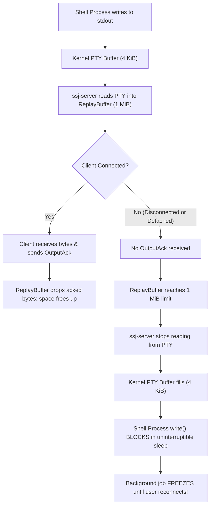
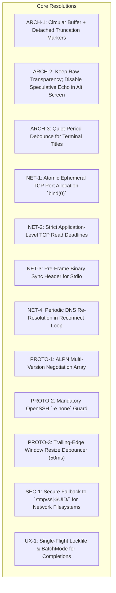

# Inherent Problems and Design Traps in `ssj` Specification

This document presents a comprehensive, rigorous architectural review of the specifications for `ssj` (*session survives jumps*), covering both the primary specification ([SPEC.md](file:///Users/tim/Repos/sss/SPEC.md)) and the fallback proposal ([FALLBACK_SPEC_PROPOSAL.md](file:///Users/tim/Repos/sss/FALLBACK_SPEC_PROPOSAL.md)).

It identifies inherent contradictions, trade-off traps, security subtleties, protocol cliffs, and edge-case failure modes present in the current design.

---

## Executive Summary & Problem Matrix

| ID | Category | Problem Summary | Severity | Impact |
| :--- | :--- | :--- | :--- | :--- |
| **ARCH-1** | Architecture | **The ReplayBuffer Dilemma**: Backpressure freezes disconnected background shells vs. dropping output causes fatal `ReplayGap`. | **Critical** | Long-running tasks freeze when detached; or sessions abort on reconnect. |
| **ARCH-2** | Terminal | **Zero-VT Parser vs. Speculative Local Echo**: Kernel PTY has no awareness of `smcup` (alternate screen); echo races with password prompts. | **High** | Broken local echo in editors; plaintext password exposure during latency spikes. |
| **ARCH-3** | Terminal | **Window Title Status Injection**: Escapes injected during network stalls split in-flight remote escape sequences; broken on non-xterm terminals. | **Medium** | Visual corruption, corrupted alternate screen / graphics modes, permanent title loss. |
| **NET-1** | Security / Transport | **Port Squatting & Local DoS**: 1,000-port range (60000–61000) on `0.0.0.0` or `127.0.0.1` can be pre-bound by any local user in $< 100\text{ ms}$. | **High** | Unprivileged local users can completely deny service to all other users on shared bastions. |
| **NET-2** | Transport | **Silent TCP Half-Open State (Tier 1)**: `ssh -W` bridge lacks QUIC transport-level heartbeats; intermediate NAT drops cause silent hangs. | **High** | Client freezes indefinitely on Wi-Fi loss instead of immediately triggering reconnect. |
| **NET-3** | Transport / Protocol | **Tier 2 Stdio Stream Pollution**: MOTD banners, `/etc/issue`, and shell profile echoes corrupt binary frame stream before handshake. | **High** | Instant session failure on enterprise/academic hosts with mandatory login banners. |
| **NET-4** | Transport | **DNS Staleness on Reconnect**: Host IP is resolved once at session start; mobile roaming or dynamic DNS IP changes loop forever. | **Medium** | Reconnect fails permanently after laptop sleep or server IP migration. |
| **NET-5** | Network | **Inbound UDP NAT Traversal Asymmetry**: `ssj-server` binds a high port expecting inbound UDP; fails when server itself is behind NAT. | **Medium** | Server cannot be contacted on cloud private subnets or home networks without port-forwarding. |
| **PROTO-1**| Lifecycle / UX | **Protocol Version Bump Lockout**: Strict `PROTOCOL` integer equality with zero backwards compatibility permanently locks users out of active sessions. | **High** | Upgrading local client binary makes attaching to running remote sessions impossible. |
| **PROTO-2**| Terminal / UX | **OpenSSH Escape Collisions (`~.`)**: `~.` triggers OpenSSH client disconnect in jump hosts and Tier 2 stdio streams. | **Medium** | Disconnects the SSH transport tunnel prematurely rather than detaching `ssj`. |
| **PROTO-3**| Terminal | **Resize Storms & `SIGWINCH` Burst**: Unbounded resize channel floodscurses programs on link recovery, causing curses race crashes. | **Medium** | `vim`, `htop`, `fzf` crash or scramble screens on window resize during latency spikes. |
| **SEC-1**  | Security | **NFS Control Socket Failure & Permission Bypass**: macOS / non-systemd fallback to `$HOME` fails on NFS mounts or leaks on root-squash. | **Medium** | Inability to create control sockets on HPC clusters; potential permission bypass on NFSv3. |
| **SEC-2**  | Security | **Unfiltered Locale & Terminfo Environment Exploits**: Wildcard `LC_*` forwarding permits glibc/locale buffer overflow vulnerabilities. | **Low / Med** | Attack surface expansion for privilege escalation via vulnerable setuid binaries. |
| **UX-1**   | CLI / UX | **Tab-Completion SSH Thundering Herd**: Background `ssj list` on tab press spawns uncontrolled concurrent SSH subshells. | **Medium** | Freezes shell completion, prompts for YubiKey touch / passphrase, or triggers SSH rate limits. |

---

## 1. Fundamental Architecture & Dilemmas (Unsolvable Trade-offs)

### ARCH-1: The ReplayBuffer Dilemma (Backpressure vs. Background Execution)

In [SPEC.md](file:///Users/tim/Repos/sss/SPEC.md) §359–§360 and [session.rs](file:///Users/tim/Repos/sss/crates/ssj-server/src/session.rs#L234-L260):
> *"Output is read from the shell only while the replay buffer has room, so a client that does not acknowledge cannot make the server buffer more than the capacity."*
> *"When the replay buffer is full, the server stops reading from the PTY (backpressure as in ssh) and never drops output."*

The replay capacity is fixed at 1 MiB (`1 << 20` in [launch.rs](file:///Users/tim/Repos/sss/crates/ssj-server/src/launch.rs#L197)).

#### The Contradiction
`ssj` is designed so that sessions survive disconnects and deliberate detaches (`~.`) to allow long-running jobs (builds, simulations, data processing) to run in the background. However:



1. **If Backpressure is strictly enforced (Current Spec):**
   A user starts `cargo build` or `python train.py` and detaches (`~.`) or closes their laptop lid. As soon as the command produces 1 MiB of logs, the PTY master is no longer read. The child process's `write(1, ...)` call blocks in the kernel. **The background task halts completely and makes zero progress while detached.**

2. **If a Ring Buffer is used instead (Dropping old unacknowledged output):**
   If `ssj-server` drops older bytes to allow the shell to continue running, `output.start()` advances.
   When the client reconnects after 10 minutes and sends `Hello::Resume { output_offset }`:
   ```rust
   if output_offset < view.output.start() {
       return Err(ErrorCode::ReplayGap);
   }
   ```
   In [run.rs](file:///Users/tim/Repos/sss/crates/ssj-client/src/run.rs):
   `ServerFrame::Error(ErrorCode::ReplayGap)` is treated as a **Fatal Error**, killing the client with:
   `"the server no longer has the output since the connection was lost"`.

#### Why this is Inherent to `ssj`'s Design
Unlike `tmux`, `screen`, or `mosh`, which maintain a virtual screen matrix (VT100 state grid) and can safely discard 50,000 lines of scrollback without desynchronizing the visible screen, `ssj` intentionally has **zero terminal emulation** (Requirement 2: pure byte stream to preserve native local scrollback). A pure byte stream with absolute monotonic offsets *cannot* discard bytes without creating an unrecoverable gap in the terminal stream.

---

### ARCH-2: Zero-VT Parser vs. Speculative Local Echo Incoherence

[FALLBACK_SPEC_PROPOSAL.md](file:///Users/tim/Repos/sss/FALLBACK_SPEC_PROPOSAL.md) §8 proposes:
> *"Client-side visual overlay (VS Code / xterm.js model), 100% untouched raw byte stream... PTY-assisted zero-heuristic suppression (`!ECHO` and `smcup`)."*
> *"The client never needs to parse or guess escape sequences from remote output... When the server PTY enters or exits alternate screen buffer, it sends `ServerFrame::TerminalMode { echo: bool, alt_screen: bool }`."*

#### The Kernel PTY Reality
**The Unix kernel PTY driver has no concept of an Alternate Screen Buffer (`smcup` / `rmcup`).**
- The Unix kernel terminal subsystem (`termios`) tracks line discipline flags: `ECHO`, `ICANON`, `ISIG`, `IXON`.
- Alternate screen buffer (`\x1b[?1049h` / `\x1b[?1047h`) is an application-level ANSI control sequence emitted by full-screen programs (`vim`, `nano`, `htop`, `less`) directly as ASCII bytes written to stdout.
- The kernel PTY does **not** inspect escape sequences and provides **no notification, signal, or ioctl** when an application enters the alternate screen.
- Therefore, the only way `ssj-server` could ever know that an application entered `smcup` is by implementing a full ANSI/VT escape sequence stream parser on the server—which directly contradicts the fundamental design rule:
  *"OpenSSH 1:1 match: Dumb pipe pass-through, no in-stream escape parsing."*

#### Password Prompt Race Condition
`termios` `ECHO` flag updates travel over network packets. When a user runs `sudo command`:
1. `sudo` prints `[sudo] password for user: ` and disables `ECHO` on the remote PTY.
2. The server sends `ServerFrame::TerminalMode { echo: false }`.
3. If the link has 150 ms latency, the user may already have typed the first 4 characters of their password.
4. Because the client has not yet received `TerminalMode { echo: false }`, **the client's speculative local echo prints the user's password in plain text on the local terminal screen!**

---

### ARCH-3: Window Title Status Injection vs. In-Flight Escape Corruption

In [SPEC.md](file:///Users/tim/Repos/sss/SPEC.md) §128–§132:
> *"Status messages go to the window title, with the title stack of xterm (`CSI 22;0t` and `CSI 23;0t`) to restore the old title... A known limit: a message written in the middle of an escape sequence of the remote side, which the output stream may be split inside, would corrupt that sequence."*

#### Catastrophic Effects of Escape Splitting
Modern terminals make heavy use of long multi-byte escape sequences:
- 24-bit TrueColor sequences: `\x1b[38;2;255;128;64m`
- OSC 52 clipboard writes: `\x1b]52;c;ZXhhbXBsZQ==\x07` (can be thousands of bytes long)
- Kitty graphics / Sixel protocol commands: `\x1b_Ga=T,f=100,...;\x1b\`

When a network connection stalls in the middle of such a sequence, `ssj-client`'s 5-second stall timer fires and writes to local stdout:
`\x1b[22;0t\x1b]0;no response from the server for 5s\x07`

This injects title bytes directly into the middle of the remote sequence!
- In modern terminals, splitting an OSC 52 or graphics payload results in the remainder of the payload being dumped onto the screen as visible raw binary garbage.
- It can cause the terminal emulator to hang in an incomplete escape state, corrupting all future output until the user types `reset`.

#### Terminal Incompatibility with XTerm Title Stack
- The XTerm title stack (`CSI 22;0t` / `CSI 23;0t`) is **not supported** by macOS Terminal.app, tmux, screen, or many VTE-based Linux terminals (e.g. older GNOME Terminal).
- In these terminals, `CSI 22;0t` is silently ignored. When `ssj` restores the title with `CSI 23;0t`, nothing happens: the window title remains stuck on `"no response from the server"` permanently.

---

## 2. Transport & Network Edge Traps

### NET-1: Local Port Squatting & Denial of Service on Shared Hosts

In both UDP mode ([SPEC.md](file:///Users/tim/Repos/sss/SPEC.md) §41) and TCP Tier 1 ([FALLBACK_SPEC_PROPOSAL.md](file:///Users/tim/Repos/sss/FALLBACK_SPEC_PROPOSAL.md) §3.1), `ssj-server` binds a high port from the range `60000..=61000`:
- UDP binds on `0.0.0.0:port` or `[::]:port`.
- TCP Tier 1 binds on `127.0.0.1:port`.

#### Vulnerability & Exploitation
The port range consists of only 1,001 ports. On any multi-user machine (e.g. university servers like `merk-ail-*`, shared bastions, research clusters):
1. **UDP Port Exhaustion:** Any unprivileged user can execute:
   ```bash
   for p in {60000..61000}; do nc -u -l $p & done
   ```
   All 1,001 UDP ports are occupied in under 100 milliseconds. When `ssj-server` runs [bind_in_range](file:///Users/tim/Repos/sss/crates/ssj-server/src/listen.rs#L29), it iterates through the range, finds every port in use, and exits with:
   `no free UDP port between 60000 and 61000`.
   Every `ssj` user on the machine is completely locked out.

2. **TCP Localhost Hijack & Stall (Tier 1):**
   In TCP Tier 1, the client executes:
   `ssh -W localhost:<tcp_port> <host>`
   An unprivileged local attacker on `<host>` can pre-bind high TCP ports on `127.0.0.1`.
   When `ssj-client` connects via `ssh -W`, it connects to the attacker's TCP socket.
   While mTLS 1.3 prevents the attacker from reading data or impersonating the server (the TLS handshake fails because the attacker lacks the ephemeral private key), the attacker can:
   - Accept the TCP connection and never send data (hanging the client indefinitely).
   - Immediately send a TCP `RST`, forcing `ssj-client` into an infinite reconnect loop.
   - Fingerprint client connection attempts and collect client TLS Handshake metadata.

---

### NET-2: Silent TCP Half-Open State (Tier 1 Fallback)

In QUIC (`ssj-net`), Quinn manages connection liveness, packet loss recovery, and path degradation at the transport layer with built-in ACK-based loss detection.

In Tier 1 Fallback, traffic flows over `ssh -W` (an SSH channel forwarding TCP).
- Intermediate firewalls, mobile carrier NATs, and home Wi-Fi routers frequently drop state entries silently without emitting a TCP `RST` or `FIN`.
- Operating system TCP keepalives default to 2 hours (`tcp_keepalive_time = 7200`).
- If a laptop sleeps or Wi-Fi drops, the local TCP socket enters a **half-open state**.
- Standard OS socket reads do *not* fail; they block indefinitely.
- Unless `ssj-client` enforces an application-level ping deadline on the `TlsStream<TcpStream>` read loop, the client will freeze with no status update, believing the connection is still alive.

---

### NET-3: Tier 2 Stdio Stream Pollution: MOTD Banners and Shell Profile Echoes

In Tier 2 ([FALLBACK_SPEC_PROPOSAL.md](file:///Users/tim/Repos/sss/FALLBACK_SPEC_PROPOSAL.md) §3.2), `ssj-stream` runs directly over standard `stdin`/`stdout` of an OpenSSH non-interactive command:
`ssh <host> "sh -c 'exec ~/.local/share/ssj/bin/ssj-server-p1 --stdio --resume <id>'"`

#### The Inherent Hazard
On enterprise, government, and university servers:
1. `/etc/motd`, `/etc/issue.net`, or `/etc/banner` print legal notices upon connection.
2. User or system-wide shell startup scripts (`/etc/profile`, `~/.bashrc`, `~/.zshrc`) frequently echo text (e.g. `fortune`, Python virtualenv activation notices, environment module loaders).
3. If `sshd` has `Banner /etc/issue.net` configured, OpenSSH writes the banner text directly to `stdout` before spawning the remote subsystem!

#### Impact on Binary Framing
`ssj-proto` expects the very first byte on the stream to be the 4-byte frame header (`[length: u16, tag: u8, flags: u8]`).
If an ASCII banner (e.g. `"Welcome to Ubuntu 24.04\n"`) is printed first:
`decode_server(&buf)` reads `"Welc"` as a frame length of `0x5765` (22,373 bytes) and tag `'l'`, which is invalid.
The client immediately aborts with:
`"the server sent an invalid frame: InvalidTag"`.
The session dies before any handshake can occur.

---

### NET-4: DNS Staleness on Reconnect

In [run.rs](file:///Users/tim/Repos/sss/crates/ssj-client/src/run.rs#L280):
```rust
let addr = resolve(&args, connect.port).await?;
```
`addr` is resolved once at the very start of `connect_session`.
Inside the session loop, `self.params.addr` is stored as a concrete `SocketAddr` (e.g. `141.84.248.11:60021`).

When the client connection drops and enters `reconnect()`:
```rust
let client = quic_client(&self.params.identity, &self.params.connect.fingerprint)?;
let conn = client.connect(self.params.addr, SERVER_NAME)...
```
`reconnect()` loops using the **same cached `SocketAddr` forever**.
- If a user roams between networks where the destination host has a different IP (e.g. split-horizon DNS, VPN vs. direct LAN), reconnect fails.
- If the target host has a dynamic IP (DDNS) that changes during a long sleep or DHCP lease renewal, `ssj-client` is stuck in an infinite reconnection loop to the old dead IP address.

---

### NET-5: Inbound UDP NAT Traversal Asymmetry

In [SPEC.md](file:///Users/tim/Repos/sss/SPEC.md) §Architecture:
- The server binds a UDP port on the remote host (e.g. 60050).
- The client connects to `(ServerIP, 60050)`.

#### The Asymmetry
This model assumes the server has a directly reachable public IP or is on the same local subnet as the client.
- In modern cloud environments (AWS EC2, GCP, Azure), virtual machines are placed in private subnets behind NAT gateways. The NAT gateway allows *outbound* connections, but drops all unsolicited *inbound* UDP packets unless a public Elastic IP and Security Group ingress rule are provisioned.
- For home developers connecting to a workstation behind a home router, inbound UDP port 60050 is blocked by default NAT firewall rules.
- Without STUN/TURN/ICE hole punching, direct UDP mode is unusable on any host that sits behind a NAT gateway.

---

## 3. Protocol, Framing & Lifecycle Traps

### PROTO-1: Total Lockout on Protocol Version Upgrades

In [SPEC.md](file:///Users/tim/Repos/sss/SPEC.md) §Protocol version:
> *"There is no backward compatibility, which keeps the code small. Every binary speaks exactly one protocol version, and two peers talk only if their versions are equal... The ALPN identifier is `ssj/N` (the only one a peer offers or accepts)."*

#### The Operational Disaster
Consider a user who has active sessions running on remote compute servers (e.g. training a PyTorch model or running a multi-day simulation).
1. The user updates `ssj` on their local laptop (via `brew upgrade ssj`, `cargo install`, or a system package update).
2. The new client binary has `PROTOCOL = 2` (or higher).
3. The user runs `ssj attach work host`.
4. The client's ALPN offers `ssj/2`. The remote server (running protocol 1) only accepts `ssj/1`.
5. The TLS handshake terminates instantly with `no_application_protocol`.
6. **The user is permanently locked out of their active sessions.**

They cannot attach to check on their simulations. Their only options are:
- Hunt down and recompile an older client binary matching protocol 1.
- Or run `ssj kill`, destroying their active running jobs.

A tool whose core value proposition is **long-lived session survival** cannot have zero protocol tolerance across client updates.

---

### PROTO-2: OpenSSH Escape Collisions (`~.`)

In [SPEC.md](file:///Users/tim/Repos/sss/SPEC.md) §Ending and leaving a session:
- `~.` detaches the `ssj` session.

#### The Conflict
In OpenSSH, `~.` is the hardcoded default escape sequence to terminate an SSH connection.
- When `ssj` connects through an SSH jump host (`ProxyJump`), OpenSSH handles the jump.
- In Tier 2 stdio fallback, `ssj` runs over an active SSH session.
- If OpenSSH has an escape character enabled (default `~`), typing `~.` at the start of a line causes **OpenSSH to immediately terminate the underlying SSH tunnel!**
- The tunnel collapses before `ssj-client` can cleanly send the `ClientFrame::Detach` frame to the server. The server treats this as an involuntary drop (starting the `detached_timeout` countdown) instead of a deliberate detach (which has no timeout).
- Every underlying OpenSSH invocation must explicitly specify `-e none`, but user `~/.ssh/config` files or environment variables can interfere.

---

### PROTO-3: Resize Storms & `SIGWINCH` Burst

In [run.rs](file:///Users/tim/Repos/sss/crates/ssj-client/src/run.rs#L305–L313):
```rust
if let Ok(mut winch) = signal(SignalKind::window_change()) {
    tokio::spawn(async move {
        while winch.recv().await.is_some() {
            if size_tx.send(window_size()).is_err() { break; }
        }
    });
}
```

#### The Problem
- When a user resizes a terminal window (e.g. dragging the window border with a mouse), the OS emits 30–60 `SIGWINCH` signals per second.
- `ssj-client` forwards each resize event as a separate `ClientFrame::Resize` frame.
- If the network experiences latency or is temporarily reconnecting, dozens of resize frames queue up.
- Upon reconnection, `ssj-server` receives a massive burst of resize frames and invokes `ioctl(TIOCSWINSZ)` in rapid succession.
- Full-screen curses applications (`vim`, `htop`, `tmux`, `fzf`) receive a storm of `SIGWINCH` signals. Many terminal programs have non-reentrant signal handlers or race conditions in curses screen buffer reallocation, leading to visual corruption or segmentation faults.
- Window resize events **must be debounced** (e.g. with a 50 ms trailing-edge timer) on both client and server.

---

## 4. Security, Multi-Tenant & Platform Edge Cases

### SEC-1: NFS Control Socket Failure & Permission Bypass

In [SPEC.md](file:///Users/tim/Repos/sss/SPEC.md) §Files and paths:
> *"Runtime: `$XDG_RUNTIME_DIR/ssj/` holds one control socket per session. macOS has no `XDG_RUNTIME_DIR`, so the fallback is `$XDG_STATE_HOME/ssj/run/`."*

#### NFS Filesystem Incompatibility
In enterprise and academic HPC environments (such as university clusters like `lrz.de` or `merk-ail-*`):
- User home directories (`/home/username`) are mounted over NFS (Network File System).
- **Unix Domain Sockets (`AF_UNIX`) cannot be created on NFS mounts.** Calling `bind()` on a socket in `~/.local/state/ssj/run/` fails with `EOPNOTSUPP` (Operation not supported on transport endpoint).
- Furthermore, NFSv3 does not enforce POSIX file permissions (`0700` / `0600`) at the server level; root squashing can cause socket creation to fail or expose permissions.
- On macOS, `$XDG_RUNTIME_DIR` is never set, so `ssj` always falls back to the home directory. If `$HOME` is on a shared network drive, `ssj-server` crashes during startup.

---

### SEC-2: Unfiltered Locale & Terminfo Environment Exploits

In [SPEC.md](file:///Users/tim/Repos/sss/SPEC.md) §Environment forwarding:
- Default `accept_env` matches `TERM`, `LANG`, and `LC_*`.
- Filter excludes `LD_*`, `DYLD_*`, and `BASH_ENV`.

#### Security Exposure
Allowing arbitrary `LC_*` variables introduces attack surface:
- In GNU libc and ncurses, multiple historical privilege escalation and arbitrary code execution vulnerabilities (e.g. CVE-2014-0475, CVE-2015-8779) were triggered by crafted `LC_ALL`, `LANGUAGE`, or `LOCPATH` variables causing setuid binaries executed within the shell to load malicious locale files or overflow buffers.
- Similarly, if `TERM` contains path traversal characters (e.g. `TERM=../../tmp/evil`), applications using `ncurses` or `terminfo` may attempt to read untrusted terminfo definition files.

---

## 5. CLI, UX & Completion Pitfalls

### UX-1: Tab-Completion SSH Thundering Herd

In [FALLBACK_SPEC_PROPOSAL.md](file:///Users/tim/Repos/sss/FALLBACK_SPEC_PROPOSAL.md) §9.9:
> *"If the cache is older than TTL or missing, the completion script launches a detached, non-blocking background subshell:*
> `(ssj list "$host" --json > "$cache_tmp" && mv "$cache_tmp" "$cache_file") >/dev/null 2>&1 &!`*"*

#### Operational Hazards
1. **Thundering Herd:** If a user presses `<TAB>` multiple times or types quickly in multiple terminal tabs, dozens of background subshells are launched concurrently, all invoking `ssh user@host "ssj-server --list"`.
2. **Hardware Key Stalls (YubiKey):** If the user's SSH key requires a touch confirmation on a FIDO2/U2F security key (e.g. `sk-ssh-ed25519`), each background process triggers a hardware request. The user is prompted to touch their key for a simple shell tab-completion!
3. **Passphrase Prompt Deadlocks:** If `ssh-agent` is not loaded, the background SSH process attempts to read a passphrase from `/dev/tty`, competing with the user's interactive shell.

## 6. Actionable Architectural Resolutions & Detailed Blueprints

Based on deep technical review and real-world system constraints, the following architectural decisions and resolutions resolve the identified inherent problems while retaining the performance and security goals of `ssj`.



---

### 6.1 Preserving Single TCP Port Performance Without Port Squatting (NET-1 Resolution)

To retain the maximum performance of Tier 1 (direct `ssh -W` TCP bridge, single persistent server process, immediate `TCP_NODELAY`, zero process spawns on reconnect, $\ge 98\%$ OpenSSH throughput) while completely eliminating port squatting and port exhaustion:

#### Atomic Dynamic Ephemeral Port Allocation (`bind(0)`)
Instead of binding within a fixed 1,000-port range (`60000..=61000`):
1. **Server Binds Ephemeral Port 0:** `ssj-server` binds port `0` directly on `127.0.0.1`:
   ```rust
   let listener = std::net::TcpListener::bind("127.0.0.1:0")?;
   let port = listener.local_addr()?.port(); // OS kernel assigns an unused ephemeral port, e.g. 43821
   ```
2. **Dynamic Range Tapping:** The OS kernel assigns an unused port from the full system ephemeral range (typically 32,768–60,999 on Linux or 49,152–65,535 on macOS / FreeBSD), providing over **28,000–32,000 available ports**.
3. **Bootstrap Propagation:** The server transmits the assigned port to the client during bootstrap:
   ```text
   SSJ CONNECT <udp_port> tcp:43821 <fingerprint>
   ```
4. **Client Bridge:** The client invokes:
   ```shell
   ssh -e none [ssh-options] <host> -W localhost:43821
   ```

**Architectural Benefits:**
- **Zero Port Exhaustion:** Thousands of concurrent sessions can run on shared multi-tenant hosts without port conflicts.
- **Zero Port Squatting / Race Conditions:** Because `bind(0)` is an atomic kernel operation, an attacker cannot predict or pre-bind the allocated port.
- **Maximum Performance Maintained:** Retains raw kernel-to-kernel socket pipe speed over the `ssh -W` bridge without extra process or pipe overhead.

---

### 6.2 Full-Screen Applications & Code Volume Analysis

#### A. Speculative Local Echo (ARCH-2) in Full-Screen Apps
- **Behavior in Full-Screen Programs (`vim`, `htop`, `tmux`, `fzf`, `less`):**
  - **Severe Visual Corruption:** In full-screen curses applications, keystrokes frequently do not correspond to character output at the current cursor position. For example, pressing `j` or `k` in `vim` moves the cursor rather than printing letters. Speculatively echoing `j` draws ghost characters across the text buffer.
  - In `fzf` or interactive prompts, typing draws characters at the cursor while the application asynchronously redraws the bottom status bar, causing severe visual drift and screen tearing.
  - In `mosh`, local echo is backed by a 15,000-line C++ virtual terminal engine (`StateEngine`), and even `mosh` **completely suppresses local prediction** whenever an alternate screen buffer or cursor positioning escape sequence is active.
- **Code Volume Estimate:**
  - **Full VT100 / XTerm Parser:** Implementing an ANSI/VT parser capable of tracking alternate screens, cursor coordinates, and escape modes requires **3,000–6,000 lines of Rust** (or adding heavy external dependencies like `alacritty_terminal` or `vte`), completely violating `ssj`'s lightweight, minimal-dependency principle.
  - **Pragmatic Decision:** Maintain 100% raw byte-stream transparency (Requirement 2). Disable speculative local echo entirely in full-screen and raw modes, or omit it from v1 core.

#### B. Tier 2 SSH Stdio Mode (`--stdio`) in Full-Screen Apps
- **Behavior in Full-Screen Programs:**
  - **100% Flawless.** Tier 2 behaves identically to native OpenSSH. Applications like `vim`, `htop`, `tmux`, and `fzf` operate over a pure, lossless byte stream with complete terminal escape transparency.
  - Terminal resizing is delivered in-band via [`ClientFrame::Resize`](file:///Users/tim/Repos/sss/crates/ssj-proto/src/frame.rs), invoking `ioctl(TIOCSWINSZ)` cleanly on the remote PTY.
- **Code Volume Estimate:**
  - **Extremely Compact (~200 lines of Rust total):**
    - **Server (~80 lines):** Add a `--stdio` mode flag in [`crates/ssj-server/src/launch.rs`](file:///Users/tim/Repos/sss/crates/ssj-server/src/launch.rs) that hooks `tokio::io::stdin()` and `stdout()` directly into the session loop.
    - **Client (~120 lines):** In [`crates/ssj-client/src/run.rs`](file:///Users/tim/Repos/sss/crates/ssj-client/src/run.rs), wrap the SSH child process's stdin/stdout pipes inside the generic transport stream.

---

### 6.3 Comprehensive Resolutions for All Remaining Problems

#### 1. Resolution for ARCH-1 (The ReplayBuffer Dilemma)
- **Problem:** Buffer backpressure freezes background jobs when disconnected; dropping bytes triggers fatal `ReplayGap`.
- **Solution:** Implement a **dual-mode circular buffer with inline truncation markers**:
  1. While a client is actively connected: maintain backpressure as normal.
  2. While disconnected or detached: once `replay_capacity` (e.g. 2 MiB) is reached, **drop oldest bytes and advance `output.start()`**, allowing the background shell process to continue running unblocked.
  3. On reconnect: if `Hello::Resume { output_offset }` has `output_offset < output.start()`, the server does **not** fail with `ReplayGap`. Instead, it accepts the connection, aligns offsets to `output.start()`, and transmits an inline terminal notice:
     ```text
     \r\n[ssj: 3.4 MiB output truncated while disconnected]\r\n
     ```
  4. The client updates its offset and resumes smoothly without session termination.

#### 2. Resolution for ARCH-3 (Window Title Escape Splitting)
- **Problem:** Injecting status updates to stdout splits in-flight multi-byte escape sequences (24-bit color, OSC 52, Kitty graphics), corrupting terminal state.
- **Solution:**
  1. Add a **50 ms quiet-period detector**: wait until no partial escape sequence is pending in the stream decoder before emitting window title updates.
  2. Eliminate the XTerm title stack (`CSI 22;0t` / `CSI 23;0t`), which fails on macOS `Terminal.app` and `tmux`. Instead, retain the previous known window title in client state and emit standard `OSC 0; <title> ST` on recovery.

#### 3. Resolution for NET-2 (Silent TCP Half-Open State)
- **Problem:** Middlebox NAT state drops cause TCP sockets to hang silently for hours.
- **Solution:**
  1. Configure OS-level TCP socket keepalive probes: `TCP_KEEPIDLE = 5s`, `TCP_KEEPINTVL = 2s`, `TCP_KEEPCNT = 3`.
  2. Implement an application-layer read deadline: if the client emits a `Ping` and receives no `Pong` or data frame within 5 seconds, it forcefully tears down the TCP socket and triggers the reconnect loop.

#### 4. Resolution for NET-3 (Tier 2 Stdio Banner & MOTD Pollution)
- **Problem:** ASCII login banners (`/etc/motd`, `/etc/issue`) written to `stdout` before `ssj-server` starts corrupt the binary frame stream.
- **Solution:**
  1. Prepend a 16-byte magic synchronization header to the `--stdio` stream: `b"\x00SSJ_SYNC_STREAM\n"`.
  2. The client frame reader discards any pre-session ASCII bytes until the synchronization sequence is observed, and only then initiates binary frame parsing.

#### 5. Resolution for NET-4 (DNS Staleness on Reconnection)
- **Problem:** Destination IP is resolved once at startup; mobile roaming or dynamic DNS IP changes cause infinite reconnect loops to dead addresses.
- **Solution:**
  In [`crates/ssj-client/src/run.rs`](file:///Users/tim/Repos/sss/crates/ssj-client/src/run.rs), move the hostname resolution logic inside the reconnect loop. Re-resolve DNS every 3rd retry attempt so that network switches and DNS updates are picked up dynamically.

#### 6. Resolution for PROTO-1 (Protocol Bump Lockout)
- **Problem:** Strict single-version equality locks users out of active background sessions when their local client is upgraded.
- **Solution:**
  Support multi-version ALPN arrays in [`ssj-net`](file:///Users/tim/Repos/sss/crates/ssj-net/src/lib.rs):
  - Client offers: `["ssj/2", "ssj/1"]`.
  - If the remote server is running protocol 1, the handshake negotiates `ssj/1` and the client operates in compatibility mode, guaranteeing access to active long-running jobs.

#### 7. Resolution for PROTO-2 (OpenSSH `~.` Escape Collisions)
- **Problem:** OpenSSH intercepts `~.` on jump hosts and stdio streams, terminating the SSH tunnel prematurely.
- **Solution:**
  Explicitly append `-e none` to all internal OpenSSH invocations across [`crates/ssj-client/src/bootstrap.rs`](file:///Users/tim/Repos/sss/crates/ssj-client/src/bootstrap.rs) (`ssh -e none -W ...`, `ssh -e none -T ...`), permanently suppressing OpenSSH escape handling.

#### 8. Resolution for PROTO-3 (Resize Flapping & `SIGWINCH` Burst)
- **Problem:** Dragging window borders emits 30–60 resizes/sec, flooding curses applications (`vim`, `htop`, `fzf`) with `SIGWINCH` signals upon link recovery.
- **Solution:**
  Wrap the client window change signal listener in a **50 ms trailing-edge debouncer**. Only transmit the final stable [`ClientFrame::Resize`](file:///Users/tim/Repos/sss/crates/ssj-proto/src/frame.rs) frame once resizing motion ceases.

#### 9. Resolution for SEC-1 (NFS Control Socket Incompatibility)
- **Problem:** macOS and non-systemd setups falling back to `$HOME` fail on NFS filesystems (`EOPNOTSUPP`) or leak permissions on NFSv3 root-squash.
- **Solution:**
  Use `statfs()` to detect if the target runtime path is mounted over NFS. If on NFS or macOS without `XDG_RUNTIME_DIR`, place control sockets under `/tmp/ssj-$UID/` with strict mode `0700`.

#### 10. Resolution for UX-1 (Tab-Completion Thundering Herd)
- **Problem:** Repeated `<TAB>` presses spawn concurrent background SSH subshells, triggering YubiKey prompts or SSH rate limits.
- **Solution:**
  1. Implement a single-flight file lock: `$XDG_CACHE_HOME/ssj/sessions/<host>.lock`. If a background refresh is already running, skip spawning another.
  2. Always include `-o BatchMode=yes -o ConnectTimeout=2` in background completion subshells so they terminate silently instead of prompting for passphrases or hardware keys.
